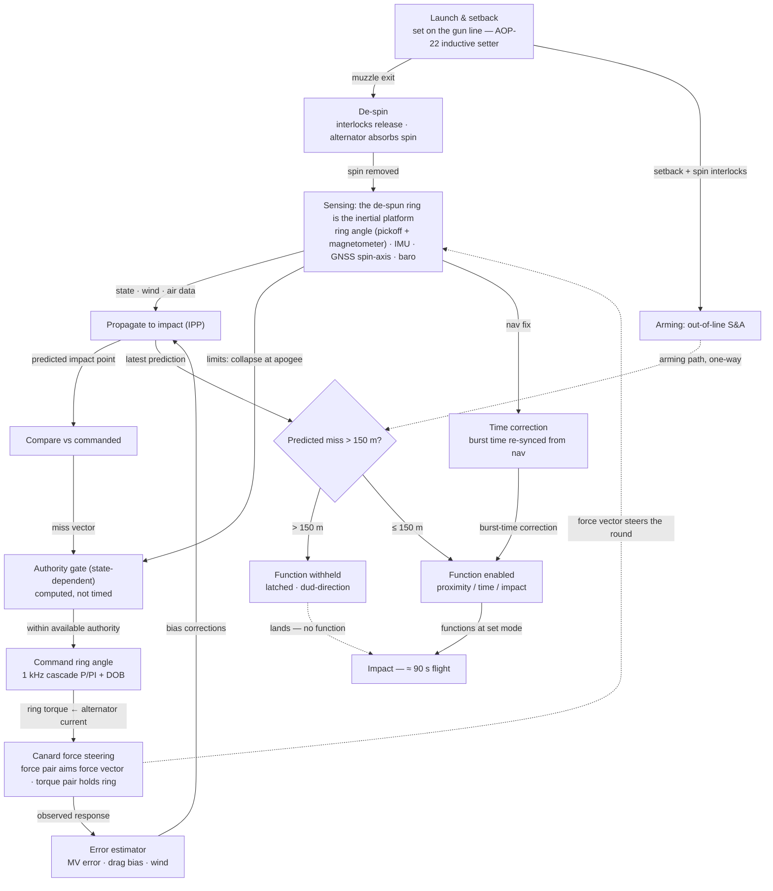

# 08 — Centerpiece flowchart spec (slide 3) — node/edge for Figma redraw

One figure on slide 3, pure node/edge grammar with a thin time-phase strip (decided 2026-10-02). It must carry the full trajectory timeline AND in-flight functioning in one read: launch/setback → de-spin → sensing (ring as inertial platform; pickoff + magnetometer; GNSS/IMU/baro) → IPP loop (propagate → compare → command ring angle) → canard force steering → state-dependent authority gate → estimator corrections → fuze events (arming, time correction) → predicted-miss decision (≤150 m arms, >150 m withholds) → impact.

**Placement:** slide 3, tall left column ≈600×648 (recommended). Wide-band fallback: same graph as 3 rows × 4 columns, ≈1248×300. The edge list below is canonical; geometry is yours.

**Visual grammar:** squared boxes, thin rules under box titles (fig4's language), mono for numbers; dashed = physical/mechanical feedback or "lands, no function"; one accent colour reserved for the withhold branch. No criterion IDs on the figure — the predicted-miss decision is printed as behaviour, never as "F16".

**Time-phase strip** (top edge or left edge): `t = 0 launch · muzzle exit · sensing continuous · guided window (gate-computed, not timed) · end game · ≈ 90 s impact`

**Footer credit line (mandatory on the figure):** `Lineage: two-pair canards + alternator as de-spin actuator — fielded M1156 specification / US 6,981,672 (2006, expired).`

## Nodes

| ID | Shape | Label | Sub-notes |
|---|---|---|---|
| N1 | rect | **Launch & setback** | set on the gun line over the AOP-22 inductive setter (mode, ToF, target, MV, met) |
| N2 | rect | **De-spin** | setback + spin interlocks release · bearing-isolated ring de-spins · alternator absorbs spin energy → bus; heat leaves through the fuze-well interface |
| N3 | container | **Sensing — the de-spun ring is the inertial platform** | chips: ring angle = pickoff (relative) + magnetometer (absolute) · IMU on the ring · GNSS on the spin-axis aperture · baro aiding (altitude / air density) |
| N4 | rect | **Propagate to impact (IPP)** | onboard aero + met model |
| N5 | rect | **Compare** | predicted vs commanded impact point |
| N6 | rect | **Authority gate (state-dependent)** | limits command where torque collapses (apogee); gate is computed, not timed |
| N7 | rect | **Command ring angle** | 1 kHz cascade P/PI + disturbance observer |
| N8 | rect | **Canard force steering** | force pair aims the force vector; torque pair holds the ring angle |
| N9 | rect | **Error estimator** | MV error, drag bias, wind → corrections (bias estimation established — integration ours) |
| N10 | rect | **Arming** | out-of-line S&A; setback + spin interlocks; armed after muzzle exit (no delay value prints) |
| N11 | rect | **Time correction** | burst time re-synced from own nav (AOP-22 command-mode basis) |
| N12 | diamond | **Predicted miss > 150 m?** | the kit's own impact prediction decides |
| N13 | terminal | **Function withheld** | latched, dud-direction — lands, no function |
| N14 | terminal | **Function enabled** | proximity / time / impact at set mode |
| N15 | terminal | **Impact** | ≈ 90 s flight |

Loop container (N4–N9) labelled **"in-flight guidance loop — 1 kHz"**. The gate sits at the command node as a limiter (state-dependent current/velocity limits); the numbered read order along the time strip follows launch → … → impact.

## Edges

| # | From → To | Label | Style |
|---|---|---|---|
| E1 | N1 → N2 | muzzle exit | solid |
| E2 | N2 → N3 | spin removed | solid |
| E3 | N3 → N4 | state · wind · air data | solid |
| E4 | N4 → N5 | predicted impact point | solid |
| E5 | N5 → N6 | miss vector | solid |
| E6 | N6 → N7 | command within available authority | solid |
| E7 | N7 → N8 | ring torque ← alternator current | solid |
| E8 | N8 → N3 | force vector steers the round — loop closes physically | dashed |
| E9 | N8 → N9 | observed response | solid |
| E10 | N9 → N4 | bias corrections: MV error · drag bias · wind | solid |
| E11 | N3 → N6 | state-dependent limits — high early & late, collapse at apogee | solid |
| E12 | N3 → N11 | nav fix | solid |
| E13 | N1 → N10 | setback + spin interlocks satisfied | solid |
| E14 | N10 → N12 | arming path — one-way, gated | dashed |
| E15 | N11 → N14 | burst-time correction | solid |
| E16 | N4 → N12 | latest impact prediction | solid |
| E17 | N12 → N13 | > 150 m | accent |
| E18 | N12 → N14 | ≤ 150 m | solid |
| E19 | N14 → N15 | functions at set mode | solid |
| E20 | N13 → N15 | lands — no function | dashed |

**Numbers allowed on the chart:** 150 m · 1 kHz · ≈ 90 s · (10,000–20,000 rpm only if N2 names the body spin, tagged "class band"). Everything else stays off the chart — figures live in bullets with honesty wording.

## Mermaid draft (restyle freely)

## Redraw notes (Figma)

- Tall variant: vertical spine N1→N2→N3→[loop]→N12→N15; loop arrows return up the left side (E8 dashed), estimator return up the right (E10). Time strip along the left edge; footer credit line across the bottom.
- Containers (N3, loop) = thin outlines with top-left group names; monochrome line work; amber/flag only on the >150 m withhold branch if you want one accent.
- fig4-system-flowchart sits top-right of the same slide as the technology map; the chart's N10/N11 pair pairs with the `21-part-fuze-train` thumb, N2's heat note with `05-shell-kit-section`, the computer with `19-part-electronics-stack`.
- Where this spec and the register disagree, the register wins and this figure is wrong.
